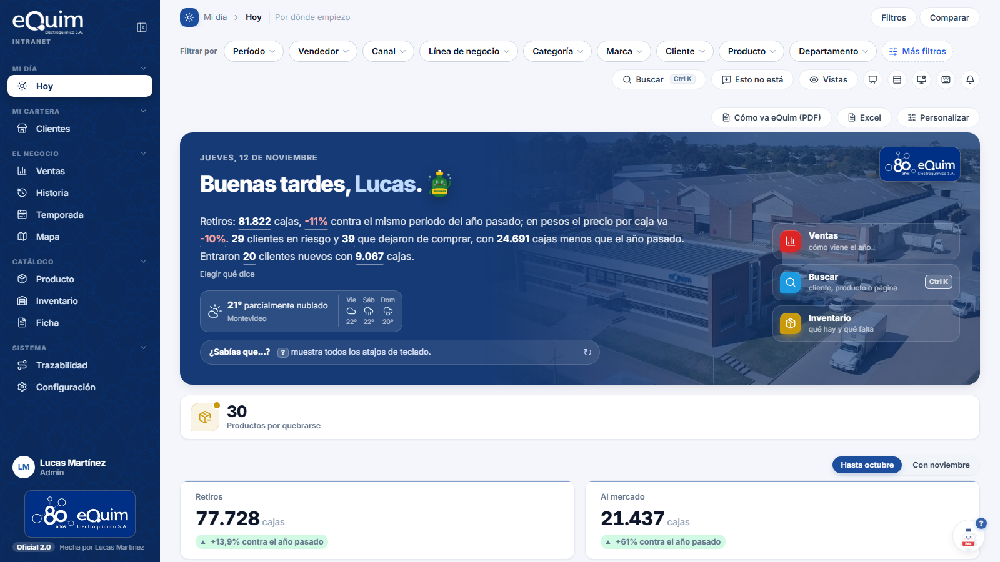
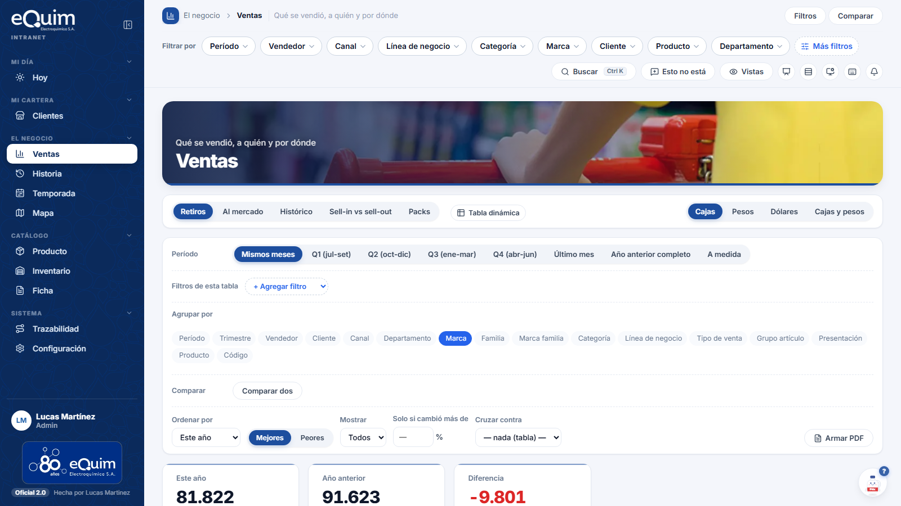
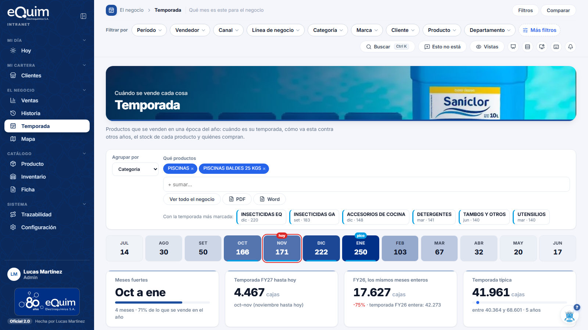
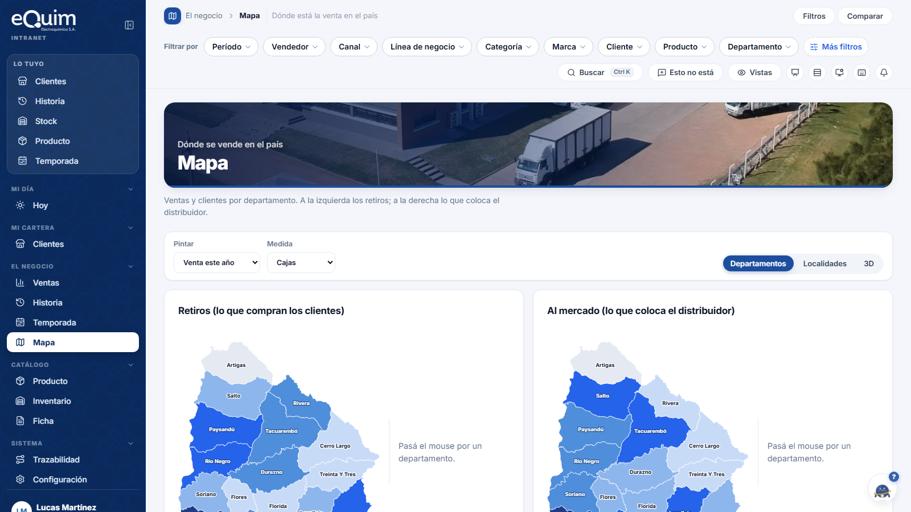
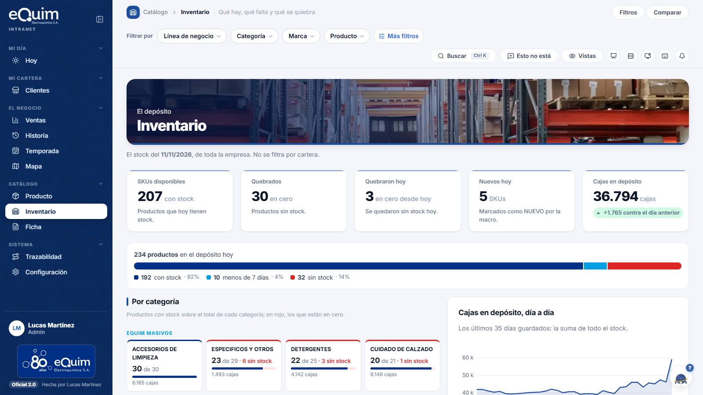
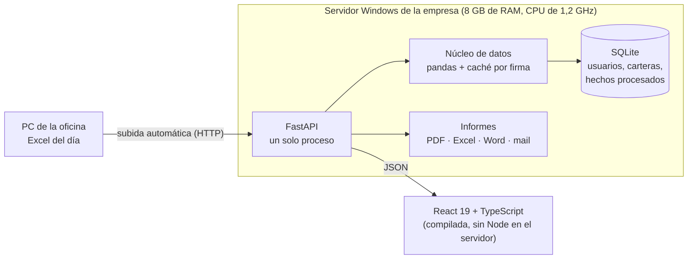
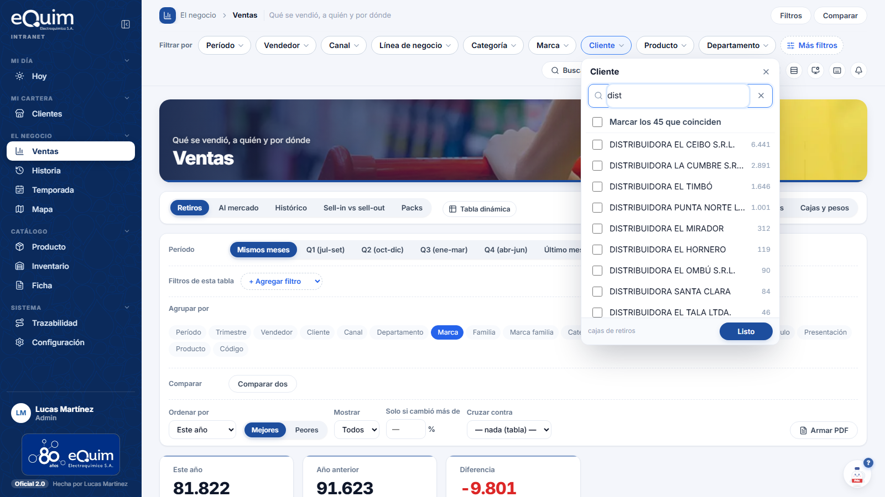

# eQuim Intranet

**De planillas de Excel sueltas a una intranet comercial que usa toda la empresa.**
Proyecto de Lucas Martínez · setiembre a diciembre de 2026 · [Presentación en PDF](docs/presentacion.pdf)



> **Sobre los datos.** Este repositorio es una presentación del proyecto. Todas las
> capturas se sacaron con **datos ficticios**: los clientes, distribuidores y vendedores
> son inventados y las cifras están alteradas (ver [`codigo/demo/datos_ficticios.py`](codigo/demo/datos_ficticios.py)).
> El código completo es de uso interno de la empresa y no se publica; acá hay fragmentos elegidos.

---

## El problema

El área comercial de una empresa uruguaya de productos de limpieza trabajaba con cuatro
planillas de Excel que nadie cruzaba:

| Archivo | Qué dice |
|---|---|
| **Retiros** | lo que la empresa le factura a cada cliente |
| **Venta al mercado** | lo que cada distribuidor coloca en sus puntos de venta |
| **Stock** | las cajas que hay hoy, por producto |
| **Histórico** | cinco años de ventas |

Cada pregunta («¿cómo viene este cliente contra el año pasado?», «¿qué se va a quebrar
antes del verano?») era una tabla dinámica armada a mano, distinta cada vez.

## Lo que hice

Una intranet web que lee esas planillas solas todos los días y las muestra cruzadas, para
unas veinte personas (dirección, vendedores, marketing, depósito) y pensada para gente que
no quiere aprender una herramienta: todo a pocos clics.

- **Hoy**: el resumen del día en una frase, con lo que cambió.
- **Ventas**: qué se vendió, a quién y por dónde; contra el año anterior, por cualquier dimensión, con tabla dinámica y PDF armado.
- **Inventario**: stock, quiebres y lo que está por quebrarse.
- **Fichas** de cliente y de producto, **Historia** de cinco años, **Temporada** (qué se vende en cada época) y **Mapa** del país.
- **Filtros de arriba** que valen en todas las pantallas y recortan los cuatro archivos a la vez.
- **Informes** en PDF, Excel y Word con la marca de la empresa; un **mail diario del stock**.
- **Usuarios, roles y carteras**: cada vendedor ve solo sus clientes.

| | |
|---|---|
|  |  |
|  |  |

## Cómo está hecha



| Capa | Con qué |
|---|---|
| Backend | Python, FastAPI, pandas, SQLite, reportlab, xlsxwriter |
| Frontend | React 19, TypeScript, Vite, TanStack Table/Query, ECharts, deck.gl, DuckDB-Wasm + Perspective |
| Pruebas | pytest, hypothesis, Playwright, vitest, fast-check |
| Desarrollo | asistido con Claude Code |

Decisiones que marcaron el proyecto:

- **Empezó en Streamlit y se migró** a FastAPI + React de a una pantalla, sin dejar de usarse.
- **El servidor es chico** y eso se respetó: un solo proceso, sin Redis ni proxy. El arranque
  perezoso bajó la memoria de unos 1.400 MB a unos 370 MB.
- **Lo calculado se guarda contra una «firma» de los datos**: cuando llega un Excel nuevo,
  nadie ve números viejos; cuando no cambió nada, no se recalcula.
- **Los números se comprueban**: cada filtro se verifica contra la cuenta hecha a mano, y las
  pantallas se recorren con un navegador automático antes de cada entrega.

## El proyecto en números

| | |
|---|---|
| Código | ~47.000 líneas de Python · ~40.000 de TypeScript y CSS |
| Pruebas | más de 850 en Python (64 archivos) y 83 en el frontend |
| Versiones entregadas | de la «Oficial 1» a la «Oficial 2.0», 47 commits en siete semanas |
| Usuarios | unas 20 personas, todos los días |

## Un caso: «los filtros no funcionan»

Un cliente se podía filtrar por su razón social pero no por el nombre con que todos lo
conocen (el de su distribuidora). Eran dos fallas tapándose una a la otra: una de datos y
una de CSS. Cómo se encontró y cómo quedó: [docs/CASO-FILTROS.md](docs/CASO-FILTROS.md).



## Qué hay en este repositorio

```
README.md                      esta página
docs/presentacion.pdf          la presentación del proyecto
docs/CASO-FILTROS.md           un bug contado de punta a punta
docs/capturas/                 las pantallas, con datos ficticios
codigo/api/filtros_globales.py el motor que aplica un filtro a cuatro archivos distintos
codigo/api/filtros_ofrecer.py  qué se ofrece para filtrar y cuánto pesa cada valor
codigo/api/habiles.py          días hábiles de Uruguay
codigo/web/ElegirFiltro.tsx    la ventanita para elegir valores (React)
codigo/pruebas/                las pruebas del motor de filtros
codigo/demo/datos_ficticios.py cómo se hicieron anónimos los datos de las capturas
```

Los fragmentos son para leer: dependen del resto del proyecto y no corren sueltos.

## Contacto

Lucas Martínez · GitHub [@Loslucas23](https://github.com/Loslucas23)
